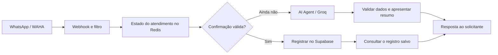

# Chatbot de chamados de TI pelo WhatsApp

Fluxo no n8n para coletar informações de suporte, apresentar um resumo e registrar o chamado no Supabase após a confirmação do solicitante.

O projeto nasceu a partir de um tutorial de integração entre n8n e WhatsApp e foi adaptado para um atendimento de TI com validação de dados, confirmação explícita e registro no banco. O desenvolvimento e a revisão contaram com apoio de IA.

## Como funciona



1. Recebe mensagens pelo WAHA.
2. Filtra o evento de mensagem e ignora mensagens do próprio bot.
3. Coleta nome, matrícula/ID, e-mail e descrição do problema.
4. Classifica a prioridade para uso interno.
5. Mostra os dados ao solicitante, sem divulgar a prioridade.
6. Solicita uma resposta como `CONFIRMAR ABC1234`.
7. Grava o chamado apenas se o código corresponder ao resumo atual e os dados forem válidos.
8. Retorna o protocolo após consultar o registro salvo.

## Tecnologias

- n8n e o nó de comunidade `n8n-nodes-waha`.
- WAHA: recebimento e envio de mensagens no WhatsApp.
- Groq Chat Model com `openai/gpt-oss-20b`.
- Redis: memória e estado de confirmação.
- Supabase / PostgreSQL: armazenamento dos chamados.

## Arquivos

- `chatbot-chamados-ti.json`: modelo importável e desativado, sem credenciais nem dados fixados.
- `schema.sql`: estrutura inicial para um projeto Supabase vazio.
- `workflow.test.cjs`: verificações isoladas de validação e confirmação, sem acesso a serviços externos.

## Instalação

### 1. Banco de dados

Em um projeto Supabase destinado a testes, execute `schema.sql` no SQL Editor. O arquivo cria a tabela `public.chamados`, suas restrições e permissões. Não execute em um banco que já tenha uma tabela com esse nome sem revisar a estrutura.

A tabela tem RLS habilitado e não concede acesso às funções `anon` e `authenticated`. A integração de backend usa uma credencial secreta com acesso de serviço. Não publique a chave.

### 2. Credenciais no n8n

Cadastre suas próprias credenciais e selecione-as nos nós correspondentes:

| Credencial | Nós |
| --- | --- |
| WAHA | Send Seen; Send a text message |
| Groq | Groq Chat Model |
| Redis | Redis Chat Memory; Ler estado do atendimento; Guardar estado do atendimento |
| Supabase | Gravar chamado; Conferir registro salvo |

O acesso autorizado do plugin Supabase no ChatGPT não substitui a credencial do Supabase no n8n.

### 3. Importar o workflow

Importe `chatbot-chamados-ti.json`. O arquivo está com `active: false`, sem credenciais, sem dados de execução e com uma rota de webhook genérica. O nó Gemini desconectado do ambiente de origem foi omitido. Na cópia pública, a chave da memória inclui sessão e contato.

O modelo usa as versões de nós exportadas da instância original. Antes de ativar, verifique a disponibilidade dessas versões e instale o nó WAHA por uma fonte confiável, se necessário.

### 4. Configurar o WAHA

Configure a sessão WAHA para receber o evento `message` e usar a URL de produção do Webhook publicado. Em contêineres, o endereço precisa ser acessível a partir do WAHA; `localhost` dentro de um contêiner aponta para ele próprio.

O mapeamento de nome do contato usa dados do motor GOWS. Outros motores ou versões do WAHA podem exigir ajuste no nó Dados.

Não deixe dados de teste fixados no Webhook. Uma execução manual com dados fixados pode reutilizar uma mensagem antiga e enviar uma resposta real.

### 5. Validar e publicar

Faça a primeira validação em ambiente de teste, com dados fictícios e o envio ao WhatsApp desativado. Depois de revisar as credenciais, os caminhos e os resultados, publique conscientemente a versão.

## Dados do chamado

| Campo | Descrição |
| --- | --- |
| id | Protocolo numérico gerado pelo banco |
| atendimento_id | Chave única usada para impedir registros duplicados nas novas tentativas |
| nome_completo | Nome do solicitante |
| matricula_id | Texto; preserva zeros iniciais |
| email | Contato validado por formato |
| descricao_problema | Relato do problema |
| prioridade_interna | CRÍTICA, ALTA, MÉDIA ou BAIXA |
| status | PENDENTE, EM_ATENDIMENTO, CONCLUIDO ou CANCELADO |
| criado_em | Data e hora com fuso |

O status inicial é `PENDENTE`. Concluir um chamado significa atualizar o status, preservando o histórico. Este fluxo ainda não fornece uma tela de gestão dos chamados.

## Confirmação e duplicação

A chave `atendimento_id` tem uma restrição UNIQUE no banco. Repetir uma confirmação mantém a chave do mesmo atendimento. Se a criação falhar, o fluxo consulta o banco antes de afirmar que houve sucesso.

Isso evita duplicar a linha para a mesma chave, mas não promete execução exatamente uma vez nem impede todas as respostas repetidas no WhatsApp. Mensagens simultâneas e falhas de rede exigem validação adicional.

O estado de confirmação expira em 50 minutos. O código associa a confirmação ao resumo, mas não substitui autenticação de usuários.

## Testes locais

Com Node.js 20 ou superior:

```sh
npm test
```

Os testes verificam dados válidos e inválidos, preservação de zeros, código incorreto, correção de informações, expiração, separação de contatos, repetição de confirmação, retorno de protocolo e estrutura do arquivo público. Eles não chamam Groq, Redis, WAHA nem Supabase.

Uma gravação de teste foi validada pelo autor no ambiente original. Esta cópia pública foi adaptada para distribuição; importe e valide no seu ambiente antes de ativar.

## Limites atuais

- O modelo pode produzir JSON inválido ou apresentar erros do provedor. Não há garantia de resposta em todas as mensagens.
- Não há interface de administração, anexos, distribuição para técnicos ou notificações de conclusão.
- Nome e conteúdo são extraídos por IA; validações de formato não comprovam a veracidade das informações.
- O filtro atual aceita mensagens recebidas com `fromMe = false`; não implementa um bloqueio adicional de grupos. Restrinja grupos no WAHA ou acrescente um filtro antes de um uso real.
- A prioridade é apenas uma classificação inicial e deve ser revisada pela equipe.
- O webhook deve ter proteção adequada ao ambiente de implantação; a cópia não configura autenticação de entrada.

## Privacidade

Este repositório não inclui credenciais, histórico de conversas ou dados dos chamados. Cadastre segredos somente no gerenciador de credenciais do n8n. Não publique capturas contendo nomes, matrículas, e-mails, contatos, protocolos reais ou chaves.

## Referências

- [Tutorial usado como ponto de partida](https://youtu.be/KkKlfAb3TSI)
- [Documentação do n8n](https://docs.n8n.io/)
- [WAHA](https://waha.devlike.pro/)
- [Supabase](https://supabase.com/docs)
